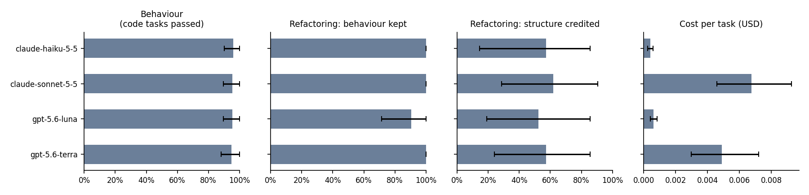
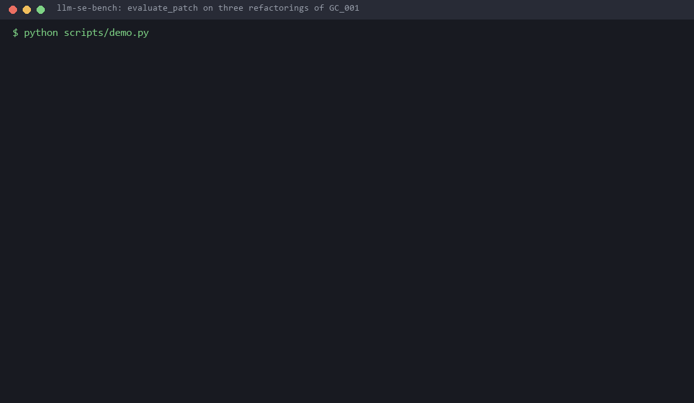

# Passing the Tests Is Not Refactoring

**An execution-based benchmark of large language models on Java, scored on
behaviour, structure and cost**

Gia Bach Vo · Personal research project · October 2026
Code, data and run artifact: <https://github.com/bachcodingg/LLM-SE-bench>

---

## Abstract

Benchmarks for LLMs on software engineering mostly ask one question: did
the tests pass? For refactoring that question is insufficient, because a
refactoring that changes nothing passes every test. This report describes
**llm-se-bench**, an execution-based harness that compiles and tests
model-generated Java in a network-isolated Docker sandbox. It records the
cost of every API call at the rates in force when the call was made, and
it scores God Class refactorings on structure as well as behaviour.

We evaluated four current models from two vendors at two price tiers on 58
tasks: code generation, bug fixing and God Class decomposition. Each model
answered every task three times, giving 696 evaluations, all executed, at a
total cost of $2.20. Two findings stand out.

1. **On the 51 code tasks, quality does not separate the models.** On 47
   tasks, every sample from every model passes. A Friedman test finds no
   difference (χ² = 1.40, p = 0.71), while the cheapest model costs about
   one seventeenth of the most expensive.
2. **On refactoring, behaviour and structure come apart.** 82 of 84
   refactorings keep the original behaviour, but only 48 earn structural
   credit, and two of the seven tasks are never credited for any model.
   What credit there is comes almost entirely from cohesion; no credited
   refactoring makes the code smaller.

We also report how the measurement was validated. A first run, in May 2026,
was withdrawn after an audit found that it had silently scored code it never
executed. The October run hit a second failure: the host ran out of memory,
and containers it killed were recorded as the models' compile errors. The
harness now detects both failures and refuses to publish such results. The
second failure was repaired by re-executing every recorded response, with
no new API calls.

---

## 1. Introduction

Execution-based benchmarks replaced text similarity as the standard for
code generation because they measure what matters: does the program do the
right thing? HumanEval [1] and MBPP [2] score a completion by running unit
tests, and SWE-bench [5] extended the idea to resolving real GitHub issues.
Across this line of work, success means that the tests pass.

That definition fits bug fixing and code generation. It does not fit
**refactoring**, which by definition changes structure without changing
behaviour. Tests can confirm that behaviour was kept, but they cannot
confirm that the structure improved. A model that returns its input
unchanged passes every test, and so does one that wraps the original logic
in new class names. A benchmark that scores refactoring on tests alone
treats preserved behaviour, which is a necessary condition, as if it were
sufficient.

Two further problems shape this work.

- **The JVM is under-served.** SWE-bench-java contains 91 verified issue
  instances [6], and SWE-PolyBench has 165 Java instances among its 2,110
  [7]. The bottleneck is partly environmental. In EnvBench, the best
  environment-setup approach correctly configured only 29.47% of JVM
  repositories [8]. When a repository cannot be built, the benchmark learns
  nothing about the model.
- **Cost is rarely scored.** Leaderboards report resolve rates, not money.
  A model that solves slightly more tasks at many times the price is not
  obviously better for anyone working within a budget.

**Contributions.**

1. A harness that compiles and runs every generated Java solution with
   `javac` and JUnit in a Docker container started with `--network=none
   --memory=256m --cpus=1`. It records whether each test actually
   executed, and refuses to publish a run that contains an unexecuted
   result.
2. A structural score for God Class refactoring. It combines four CK-metric
   axes with published weights. It scores coupling and cohesion on the
   classes the refactoring *extracted*, and it guards against five gaming
   patterns, each refusal explained in plain language.
3. A three-axis evaluation of four current models (behaviour, structure and
   cost, reported side by side and never summed), with the full artifact
   committed and verifiable against a fresh rebuild.
4. An account of two ways the measurement itself failed, and the checks
   that now catch each.

## 2. Background and related work

**Execution-based code benchmarks.** HumanEval [1] introduced unbiased
pass@k and functional-correctness scoring on hand-written Python problems;
MBPP [2] added crowd-sourced entry-level problems. MultiPL-E [3] translated
both into other languages, including Java. These benchmarks are small,
public and old, so near-ceiling scores and training-data contamination are
expected; we use them as a calibration floor, not a measurement of
capability.

**Bug fixing.** Defects4J [4] indexes real, reproducible Java defects with
failing tests. SWE-bench [5] frames repository-level issue resolution;
SWE-bench-java [6] and SWE-PolyBench [7] extend it beyond Python, and
EnvBench [8] documents how often the environment, not the model, is the
obstacle on the JVM.

**Refactoring and design quality.** The Chidamber–Kemerer suite [9] defines
the object-oriented metrics used here: weighted methods per class (WMC),
coupling between objects (CBO), lack of cohesion in methods (LCOM) and
others. A God Class concentrates too much of a system's logic and state in
a single class; Lanza and Marinescu [10] give the metric-based detection
strategy that motivates the tasks. Decomposing a God Class is a classic
refactoring [11]. To our knowledge, no widely used LLM benchmark scores the
*structural* outcome of a refactoring alongside its behavioural outcome.

**Statistics.** Following Demšar [12], models are compared with the
non-parametric Friedman test over paired per-task scores, and uncertainty is
reported with bootstrap intervals over tasks [13].

## 3. Benchmark design

### 3.1 Tasks

| Dataset | Tasks | Origin | What a pass means |
|---|---|---|---|
| `humaneval-java` | 23 | Problems from HumanEval [1], Java translation and JUnit suites written for this benchmark | Compiles; every test passes |
| `mbpp-java` | 18 | Problems from MBPP [2], same treatment | Compiles; every test passes |
| `defects4j` | 10 | Standalone 10–30 line classes reconstructing real Defects4J [4] defects; no upstream code copied | The fixed class passes the suite that caught the defect |
| `godclass` | 7 | Written for this project, from the author's thesis work on God Class detection | Every behaviour test passes **and** the structure is credited (§3.3) |

All 58 tasks are single-file. Every JUnit suite is original. Some test
cases are hidden from the prompt and still scored, so a solution cannot be
fitted to the examples it was shown. Licences and provenance for every task
are in `data/PROVENANCE.md`.

The refactoring prompt gives the model the original class and its baseline
CK metrics. It asks for a decomposition into single-responsibility
classes, and requires that the original `public class` keep every public
constructor, method and nested type, with the same signatures, because a
hidden JUnit suite calls that API. Everything goes in one file, with the
extracted classes package-private.

### 3.2 Execution

Each generated solution is written to a fresh staging directory, compiled
with `javac` against JUnit 4 inside the sandbox image (JDK 17), and run
with `JUnitCore`. The verdict is `pass` (all tests), `partial` (some),
`fail` (none) or `error` (did not compile). No LLM judges any output.

Every result carries an `executed` flag, which is true only when `javac` and
JUnit actually ran in a container. Two situations leave it false:

- **No Docker.** The sandbox falls back to a structural check that credits
  every `@Test`, and outside an explicit dry run that is recorded as an
  error, not a pass.
- **A container killed before it produced any output.** `javac` and JUnit
  always explain a failure, so silence means the container was killed, and
  the result is recorded as *not executed* rather than charged to the model.

The artifact builder refuses a run with any unexecuted row (§6).

### 3.3 Structural score

`quality/structural.py` parses the original and the refactored source,
computes CK metrics for every class, and combines four axes into a composite
score with published weights:

| Axis | Weight | Measured on |
|---|---|---|
| Coupling reduction (CBO) | 0.30 | The classes the refactoring extracted |
| Cohesion improvement (LCOM) | 0.30 | The classes the refactoring extracted |
| Complexity dispersal (WMC) | 0.25 | How evenly WMC is spread across all resulting classes |
| Size reduction (LOC) | 0.15 | All classes; penalised when the reduction is deletion |

The class that keeps the original's name is treated as a **facade**. The
prompt requires it to keep the public API, so it is expected to couple to
the extracted classes, and its coupling is not counted against the
refactoring. In exchange, it must give up more than half of the original's
branching, measured as `max(0, WMC − methods)`.

A refactoring is **credited** only if all three conditions hold:

1. its behaviour suite passes and the public API is unbroken;
2. its composite score is positive;
3. no anti-gaming guard fires.

The guards target five patterns, each of which improves some CK metrics
without improving the design:

| Pattern | Why it would otherwise score |
|---|---|
| Extracted classes that declare no methods | Empty classes improve coupling and cohesion for free |
| A facade that keeps the original's branching | Classes are added *around* the logic, not extracted from it |
| Behaviour lost: methods of the original that no longer exist anywhere | Deleting code improves every metric simultaneously |
| Size collapsed far below the original | The same attack, measured by size |
| A broken public API | Not a refactoring, whatever the metrics say |

A sixth signal, extracted classes holding a single trivial method, is
recorded as a warning but does not block credit on its own: small
delegating classes are sometimes the right design.

Every refusal produces a plain-language reason, for example: "OrderProcessor
still holds 100% of the original's branching. Classes were added around the
logic, not extracted from it."

### 3.4 Cost

Every API call writes a cost record with its token counts **and the
per-token prices in force at that moment**, keyed by response ID. Run cost
is the sum of the records for the responses that run actually scored, so
other activity on the same machine (connectivity checks, agent episodes) is
never charged to it. Prices that change after the run cannot change its
recorded cost.

### 3.5 Sampling

Each (model, task) pair is sampled three times, and the sample index is part
of the response-cache key, so the three samples are three real API calls.
All four models in this run reject a temperature parameter and therefore
ran at their providers' default sampling; no provider exposes a seed. Three
samples detect gross instability and nothing finer.

## 4. Experimental setup

| Model | Vendor | Tier | Price (USD per 1M input / output tokens) |
|---|---|---|---|
| `claude-sonnet-5-5` | Anthropic | Mid | $2 / $10 |
| `claude-haiku-5-5` | Anthropic | Low | $0.10 / $0.50 |
| `gpt-5.6-terra` | OpenAI | Mid | $2 / $12 |
| `gpt-5.6-luna` | OpenAI | Low | $0.20 / $1.20 |

All API calls were made within about half an hour on 27 October 2026.
Every task was posed as a single completion: one prompt template per task
type, no tools, no retries on wrong answers. A Gemini model was planned, but
the available key had only free-tier quota (20 requests a day), so it was
excluded rather than run on a partial set of tasks.

The run artifact, `results/2026-10-run/`, records:

- **Identity:** model identifiers, SHA-256 hashes of every prompt template
  and dataset file, the sandbox image digest, and the git commit.
- **Volumes:** token counts and cost per model.
- **Repairs:** which rows were deduplicated or re-executed, and which
  verdicts changed as a result.

`scripts/build_run_artifact.py --check` rebuilds the artifact and confirms it
matches the committed copy byte for byte.

## 5. Results

### 5.1 Overview

| Model | HumanEval (23) | MBPP (18) | Defects4J (10) | God Class: credited (7) | All 58 | Total cost | Mean latency |
|---|---|---|---|---|---|---|---|
| `claude-sonnet-5-5` | 100% | 94.4% | 86.7% | 61.9% | 91.4% | $1.17 | 4.1 s |
| `claude-haiku-5-5` | 100% | 94.4% | 90.0% | 57.1% | 91.4% | $0.07 | 3.5 s |
| `gpt-5.6-terra` | 100% | 94.4% | 83.3% | 57.1% | 90.2% | $0.85 | 4.1 s |
| `gpt-5.6-luna` | 100% | 94.4% | 86.7% | 52.4% | 90.2% | $0.11 | 5.6 s |

Pass rates are over all three samples (69, 54, 30, 21 and 174 evaluations
per model respectively). The leaderboard below keeps the three axes apart,
with 95% bootstrap intervals over tasks:



| Model | Code tasks passed (51) | Refactoring: behaviour kept | Refactoring: structure credited | Cost per task |
|---|---|---|---|---|
| `claude-sonnet-5-5` | 95% (90–100) | 100% (100–100) | 62% (29–90) | $0.0068 |
| `claude-haiku-5-5` | 96% (90–100) | 100% (100–100) | 57% (14–86) | $0.0004 |
| `gpt-5.6-terra` | 95% (88–100) | 100% (100–100) | 57% (24–86) | $0.0049 |
| `gpt-5.6-luna` | 95% (90–100) | 90% (71–100) | 52% (19–86) | $0.0006 |

### 5.2 Code generation and bug fixing: saturated

Of the 51 code tasks, **47 are passed by every sample of every model**. Two
are failed by every sample of every model: `D4J_Lang_7` and `MBPP_1`. A
universal failure may be a defect in the task rather than the models, and
these two have not yet been audited. Only two tasks separate the models at
all: `D4J_Closure_4`, where one sample does not compile, and
`D4J_Mockito_6`, where three samples pass only part of the suite.

The Friedman test over per-task pass rates finds no difference among the
four models (χ² = 1.40, p = 0.71). On weighted score the result is the same
(χ² = 1.29, p = 0.73). With a ceiling this close, absence of evidence is
not evidence of equal capability; it shows these tasks cannot measure the
difference. What they do show is that **for tasks of this kind, the choice
is about price**. `claude-haiku-5-5` matches `claude-sonnet-5-5` at
$0.0004 per task against $0.0068.

### 5.3 Refactoring: behaviour kept, structure mostly not improved

| Task | Class | Behaviour kept (of 12) | Structure credited (of 12) |
|---|---|---|---|
| GC_001 | `OrderProcessor` | 12 | 12 |
| GC_002 | `UserManager` | 12 | 3 |
| GC_003 | `ReportGenerator` | 12 | 12 |
| GC_004 | `ProductCatalog` | 12 | **0** |
| GC_005 | `EventBus` | 10 | 10 |
| GC_006 | `FileProcessor` | 12 | 11 |
| GC_007 | `SessionManager` | 12 | **0** |
| **Total** | | **82 of 84** | **48 of 84** |

Every model kept behaviour on almost every refactoring. The only failures
are two `gpt-5.6-luna` samples on GC_005, which do not compile: each passes
a method reference to `publish` where its argument types do not fit. **A tests-only benchmark would
have scored 82 of 84 as solved.** The structural score credits 48.

**Where the credit comes from.** Across the 48 credited refactorings, the
mean axis scores are:

| Axis | Mean score | Refactorings where it is non-zero |
|---|---|---|
| Cohesion improvement | 0.93 | 48 of 48 |
| Complexity dispersal | 0.26 | 36 |
| Coupling reduction | 0.10 | 20 |
| Size reduction | 0.00 | **none** |

The models split classes into cohesive groups. They do not make the code
smaller: adding class declarations and delegating methods always outweighs
anything removed.

**Why 34 behaviour-preserving refactorings were not credited.**

- **Composite score at or below zero (24).** These made the structure
  slightly worse on balance.
  - GC_004: all 12 samples, composites between −0.045 and −0.021.
  - GC_007: all 12 samples, composites between −0.042 and −0.016. Every
    one also extracted two classes holding a single trivial method (a
    warning, not a refusal).
- **Stopped by an anti-gaming guard (10).** Nine of these are GC_002, where
  `UserManager` kept 75% or more of the original's branching: the
  refactoring wrapped the logic in new classes instead of moving it out.

**Across models**, the credited rate does not differ significantly
(Friedman p = 0.80 over seven tasks), and the bootstrap intervals span 60
to 70 percentage points. Seven tasks can show that *kept* and *credited*
differ; they cannot rank models on structure.

### 5.4 Cost, latency and stability

| Model | Total cost | Cost per task | Input tokens | Output tokens | Mean latency rank (1 = fastest) |
|---|---|---|---|---|---|
| `claude-sonnet-5-5` | $1.1749 | $0.0068 | 82,065 | 101,073 | 2.43 |
| `claude-haiku-5-5` | $0.0706 | $0.0004 | 82,065 | 124,838 | 1.60 |
| `gpt-5.6-terra` | $0.8520 | $0.0049 | 52,428 | 62,266 | 2.28 |
| `gpt-5.6-luna` | $0.1067 | $0.0006 | 52,428 | 80,218 | 3.69 |

Cost spans a factor of 17 at equal code-task quality. Latency differs
significantly (Friedman χ² = 79.1, p < 0.001); `claude-haiku-5-5` is the
fastest as well as the cheapest. A verdict differs between the three samples
in 8 of 232 (model, task) pairs (3.4%): 3 each for the two OpenAI models, 2
for `claude-sonnet-5-5`, none for `claude-haiku-5-5`.

## 6. Validating the measurement

The most transferable lesson of this project is that a harness can be wrong
without failing loudly. It failed twice. Both failures inflated or deflated
scores without any error being raised, and each is now caught by a check
and a test.

### 6.1 The withdrawn May 2026 run

A first run of three earlier models (522 evaluations, $3.52) reported pass
rates of 97–100% on every model. An audit in October found four defects,
any one of which invalidated the pass rates:

| Defect | Evidence | Fix |
|---|---|---|
| **The sandbox silently fell back to its no-Docker structural check**, which credits every `@Test` as passing. | One recorded "pass" declares six `public` top-level classes in one file, which `javac` rejects. 30 evaluations completed within 0.44 s of each other, too fast for container start-up and compilation. | Results carry an `executed` flag. A real run refuses to start without Docker. An unexecuted result is an error, never a pass. |
| **Repeated runs were cache hits.** | For 165 of 174 model–task pairs, runs 2 and 3 returned the run-1 response with identical latency. | The sample index is part of the cache key. |
| **The God Class suites asserted `true`.** | `assertTrue(..., true)` | Real JUnit suites that exercise each original's public API. Each original passes its own suite. |
| **The structural scorer credited an unchanged class** if it declared a nested type. | An unchanged class, submitted as its own refactoring, was credited. | Fixed and covered by a regression test, along with the facade rule in §3.3. |

The May pass rates are withdrawn. Its cost figures were recorded per call,
independently of the sandbox, and still stand.

### 6.2 The October 2026 run

The October run executed on a 16 GB Windows host where Docker shared memory
with the rest of the system. Part-way through, the host ran out of memory.
Containers killed mid-compilation exited with no output, and the sandbox
recorded that as a compile error against the model.

**Effect.** The two low-cost models appeared to fail MBPP almost entirely:
0% and 9%, against 100% on HumanEval. That discrepancy prompted the
investigation.

**Cause.** The failing outputs compiled and passed when re-run by hand. The
error message was empty for two reasons: the container had been killed,
and the sandbox read `javac`'s output from stderr although the command
redirects it to stdout.

**Repair.** Every model response is stored in the response cache, keyed by
its ID. `scripts/reexecute.py` re-scored all 696 recorded responses
through the corrected sandbox, on a host with Docker capped at 4 GB, using
the same scoring code as a live run and **making no API calls**. Exactly
the 100 affected MBPP verdicts changed (97 to pass, 3 to partial), and no
other verdict in any dataset moved.

**Prevention.** A container that exits non-zero with no output is now
recorded as *not executed*, and the artifact builder refuses any run that
contains one.

**Duplicates.** Two overlapping run processes recorded 27 God Class samples
twice. Each pair consisted of two real, independent calls, but they shared
one code file and one cache slot, so only the later call's code survived.
The later row of each pair is kept regardless of its verdict, because it is
the only one that can still be audited. The 27 dropped rows and their
$0.06 are recorded in the manifest.

## 7. Threats to validity

**Construct validity.**

- **The structural score is one operationalisation of "better design".**
  The weights, the facade threshold and the guards are documented and
  tested, but a different reasonable choice would move the credited rates.
- **The guards can still be gamed.** Mechanically grouping methods by name
  can score on cohesion without being better code.
- **The prompt shows the metrics.** It gives the baseline CK metrics and
  asks the model to reduce WMC and CBO, so models are steered towards the
  very metrics the score measures.

**Internal validity.**

- **Unaudited tasks.** Two code tasks fail for every model and may be
  defective.
- **Default sampling.** All four models ran at their providers' default
  sampling, not at temperature 0.
- **Small samples.** Three samples per task and seven refactoring tasks
  give low power, so a non-significant result here means "not enough data"
  as much as "no difference".

**External validity.**

- **Single-file tasks.** There is no build system and no cross-file
  context, which deliberately sidesteps the environment-setup problem [8].
  The results say nothing about real repositories.
- **Reconstructed defects.** The Defects4J tasks reconstruct defects in
  standalone classes, so fixing `D4J_Lang_1` here does not mean fixing
  Commons Lang.
- **Likely contamination.** The 41 HumanEval- and MBPP-derived tasks come
  from public problem sets that predate every model, so treat those scores
  as an upper bound.
- **Narrow scope.** Four models, one prompt template per task type, one
  single-shot scaffold, one point in time.

## 8. Beyond single-shot: built, not yet run

The harness includes components for the next stage. They are implemented
and tested offline, but have **not** been exercised at scale; that is stated
here so that *built* is not read as *demonstrated*.

- **Agent harness.**
  - **Loop:** a tool-calling loop with five tools, six enforced
    termination conditions (success, steps, tokens, cost, no progress, wall
    clock) and a cost ceiling checked before each call.
  - **Recording:** every step is recorded, so episodes can be re-scored
    without API calls.
  - **Scaffolds:** four are available behind one interface (single-shot,
    ReAct, plan-then-execute, external), so model quality can be separated
    from scaffold quality.
  - **Status:** a smoke episode solved `D4J_Lang_1` in five steps for
    €0.02.
- **Agent study.** It sweeps per-episode euro budgets for the same four
  models against the single-shot baseline above. A second sweep lets the
  agent write to the test files and reports a **clean solve rate** next to
  the raw one, so that tampering with the tests is not counted as a solve.
  It is capped in code at a few euros and has not been run for lack of
  budget.
- **Tamper detection.** Three layers:
  - an immutable test manifest, which cannot produce a false positive;
  - static detectors for known cheats, which are never allowed to strike a
    result on their own;
  - held-out suites.
- **Task factory.** It mines merged pull requests from JVM repositories,
  builds reverse patches, derives fail-to-pass and pass-to-pass test sets,
  detects Maven and Gradle builds, and applies six admission gates,
  including a flake check. It is tested against fixtures and has never been
  run against a real repository.
- **Tools for agents.** Three MCP servers expose the sandbox, the benchmark
  and the God Class tools to an agent. `evaluate_patch` returns the
  structural verdict and its reasons, so an agent can iterate until a
  refactoring is credited. `scripts/demo.py` shows the three cases in about
  ten seconds:
  - the unchanged class: *partial*;
  - the class plus three empty shells: *partial*, even though every metric
    improves;
  - a real model decomposition: *pass*.



## 9. Conclusion

On single-file code generation and bug fixing, four current models from two
vendors are indistinguishable, and the defensible choice is the cheapest
one. On God Class refactoring, the same models almost always preserve
behaviour and only about half the time improve structure. Even when they
do, the improvement is almost entirely cohesion, and the code never gets
smaller. A benchmark that scores refactoring on tests alone would have
reported near-total success.

The next steps follow from the limitations:

- **Scale.** Many more refactoring tasks, drawn from real repositories by
  the task factory, so that models can be ranked on structure and not just
  separated from the tests.
- **Agents.** Agentic evaluation with a clean solve rate, so that a solve
  obtained by editing the tests does not count.
- **Scaffolds.** A scaffold comparison against an external harness, so that
  conclusions are about models and not about one loop.

The broader lesson is about measurement. This harness was wrong twice, both
times silently, and both times in ways that would have produced a
publishable-looking table. The checks that now catch those failures are,
arguably, its most reusable part.

---

## Reproducibility

```bash
git clone https://github.com/bachcodingg/LLM-SE-bench && cd LLM-SE-bench
pip install -e ".[dev]"
docker build -t llm-se-bench-sandbox:17 bench/sandbox/
cp .env.example .env                       # API keys
scripts/run_2026_10.sh                     # ~$2.20; one process at a time
python scripts/reexecute.py                # optional: re-score from the cache, no API calls
python scripts/build_run_artifact.py       # results/2026-10-run/
python scripts/leaderboard.py --run results/2026-10-run
python scripts/build_run_artifact.py --check   # verify against the committed artifact
```

Model outputs will differ between runs (no provider exposes a seed), costs
follow current prices, and the sandbox base image is a moving tag whose
digest is recorded. Details: `docs/reproducing.md`. Statistics in §5 can be
recomputed from `results/2026-10-run/evaluations.csv`.

## References

1. M. Chen et al. *Evaluating Large Language Models Trained on Code.*
   arXiv:2107.03374, 2021.
2. J. Austin et al. *Program Synthesis with Large Language Models.*
   arXiv:2108.07732, 2021.
3. F. Cassano et al. *MultiPL-E: A Scalable and Polyglot Approach to
   Benchmarking Neural Code Generation.* IEEE Transactions on Software
   Engineering, 2023.
4. R. Just, D. Jalali, M. D. Ernst. *Defects4J: A Database of Existing Faults
   to Enable Controlled Testing Studies for Java Programs.* ISSTA, 2014.
5. C. E. Jimenez et al. *SWE-bench: Can Language Models Resolve Real-World
   GitHub Issues?* ICLR, 2024.
6. D. Zan et al. *SWE-bench-java: A GitHub Issue Resolving Benchmark for
   Java.* arXiv:2408.14354, 2024.
7. M. S. Rashid et al. *SWE-PolyBench: A Multi-Language Benchmark for
   Repository-Level Evaluation of Coding Agents.* arXiv:2504.08703, 2025.
8. A. Eliseeva et al. *EnvBench: A Benchmark for Automated Environment
   Setup.* arXiv:2503.14443, 2025.
9. S. R. Chidamber, C. F. Kemerer. *A Metrics Suite for Object Oriented
   Design.* IEEE Transactions on Software Engineering 20(6), 1994.
10. M. Lanza, R. Marinescu. *Object-Oriented Metrics in Practice.*
    Springer, 2006.
11. M. Fowler. *Refactoring: Improving the Design of Existing Code.*
    Addison-Wesley, 1999.
12. J. Demšar. *Statistical Comparisons of Classifiers over Multiple Data
    Sets.* Journal of Machine Learning Research 7, 2006.
13. B. Efron, R. J. Tibshirani. *An Introduction to the Bootstrap.* Chapman
    & Hall, 1993.
